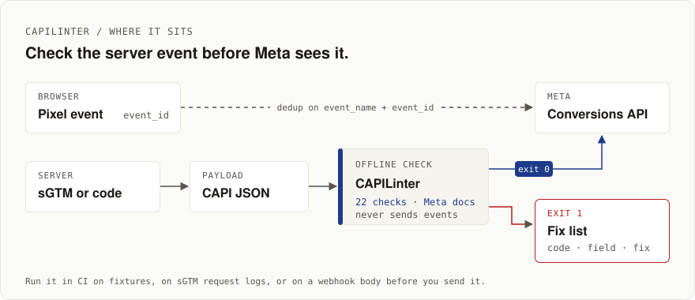

<p align="center">
  
</p>

<h1 align="center">CAPILinter</h1>

<p align="center">
  <strong>A Conversions API event can be accepted and still fail to match or deduplicate. Check the payload before it leaves your server.</strong>
</p>

<p align="center">
  21 rules traced to Meta's docs · normalizes and hashes 10 customer fields · runs offline, zero dependencies · CLI and JSON for CI
</p>

<p align="center">
  <a href="https://github.com/ChristopherLandaverde/capilinter/actions/workflows/ci.yml"></a>
  <a href="pyproject.toml"></a>
  <a href="pyproject.toml"></a>
  <a href="pyproject.toml"></a>
  <a href="LICENSE"></a>
</p>

<p align="center">
  <a href="#try-it">Try it</a> · <a href="#what-it-checks">What it checks</a> · <a href="docs/meta-rules.md">Rules and sources</a> · <a href="#known-limits">Known limits</a> · <a href="#privacy">Privacy</a>
</p>

For engineers running Meta's Conversions API from sGTM, a webhook or their own server, and for anyone auditing a CAPI setup they didn't build. A raw email in `user_data`, a phone hashed with its `+`, a missing `event_id`, a timestamp in milliseconds: Meta can accept the request and still fail to match the user or deduplicate against the pixel. CAPILinter reads the payload JSON, says what is wrong, cites the rule, and prints the normalized hash to send instead. It never sends anything to Meta.

<p align="center">
  
  <br><sub>Real CLI output on the bundled synthetic fixtures, no client data. CI regenerates this image from the installed package and fails if a line changes.</sub>
</p>

## Where it sits

<p align="center">
  
</p>

## Who it's for

| You are | You come to |
|---|---|
| An engineer shipping CAPI from sGTM or server code | Fail the build before a payload with raw PII or a missing dedup key reaches production |
| A consultant auditing a CAPI setup you didn't build | Hand over a list of findings, each with a code, the field and the rule in Meta's docs |
| An analyst whose Events Manager numbers don't match the CRM | Check whether the payload is the reason before blaming attribution |

## What you get

- **Know where PII leaves unhashed.** Raw emails and phones in `user_data`, uppercase or malformed hashes on any of the 10 customer fields.
- **Know whether pixel and server events will deduplicate.** Missing `event_id`, repeated `event_name` + `event_id` pairs in one batch, malformed `fbc` and `fbp`.
- **Know whether Meta will take the event at all.** `event_time` in milliseconds, in the future, or older than 7 days; unknown `action_source`; website events without `client_user_agent` or `event_source_url`.
- **The hash to send instead.** `capilinter hash` normalizes email, phone, name, city, state, zip, country, gender and date of birth the way Meta documents, and refuses values it would have to guess.
- **A rule you can point to.** Each check has a code and a row in [docs/meta-rules.md](docs/meta-rules.md) citing the Meta page it comes from.

## Try it

```bash
pip install "git+https://github.com/ChristopherLandaverde/capilinter.git"
git clone https://github.com/ChristopherLandaverde/capilinter.git && cd capilinter
capilinter inspect fixtures/unhashed_pii.json            # the failing step above
capilinter inspect fixtures/unhashed_pii_repaired.json   # the passing step
```

Then point it at your own payload: a single event, an array of events, or a full `{"data": [...]}` request body.

## Use it

```bash
capilinter inspect payload.json            # check a payload
capilinter inspect payload.json --strict   # warnings fail the run too
capilinter inspect payload.json --json     # machine-readable report for CI
capilinter hash "  John_Smith@gmail.com "   # sha256 of john_smith@gmail.com
capilinter hash "(650)555-1212" --phone     # sha256 of 16505551212
capilinter hash "07911 123456" --phone --country-code 44   # sha256 of 447911123456
capilinter hash "2/16/1997" --field db      # sha256 of 19970216
```

| Exit | Meaning |
|---|---|
| `0` | Every event passed |
| `1` | A check failed, or the file has no events |
| `2` | Unreadable file, invalid JSON, a non-CAPI shape, or a value `hash` cannot normalize |

Errors always fail the run. Warnings (stale `event_time`, uppercase hashes, malformed `fbc`/`fbp`, duplicate IDs in a batch) fail it only under `--strict`. Staleness is a warning because the check uses the clock at audit time, so replaying last month's sGTM logs would flag every event. Use `--strict` on payloads you are about to send.

Every flow above has a [recorded run](docs/transcripts/) of real output.

## What it checks

| Area | Checks | Codes |
|---|---|---|
| Required fields | `event_name`, `event_time`, `action_source`, `user_data`; `client_user_agent` and `event_source_url` on website events | `MISSING_*`, `INVALID_ACTION_SOURCE`, `NO_CUSTOMER_INFORMATION` |
| Timestamps | seconds not milliseconds, not in the future, not NaN or text, at most 7 days old | `EVENT_TIME_*`, `INVALID_EVENT_TIME_*` |
| Deduplication | `event_id` present; no repeated `event_name` + `event_id` in a batch | `MISSING_EVENT_ID`, `DUPLICATE_EVENT_ID` |
| Hashing | `em ph fn ln ct st zp country ge db` are lowercase SHA-256; raw email and phone named as such | `RAW_PII_UNHASHED_*`, `INVALID_SHA256`, `HASH_NOT_LOWERCASE` |
| Browser IDs | `fbc` and `fbp` match `fb.<0-2>.<13-digit ms timestamp>.<id>`, unhashed | `MALFORMED_FBC`, `MALFORMED_FBP` |

All 21 rules, their Meta sources, and the 7 that v0.1 got wrong are in [docs/meta-rules.md](docs/meta-rules.md).

<details>
<summary>How <code>capilinter hash</code> normalizes each field</summary>

| Field | Normalize | Example |
|---|---|---|
| `em` | trim, lowercase | `John_Smith@gmail.com` → `john_smith@gmail.com` |
| `ph` | digits only, country code, no `+`, `00`, `(0)` or leading zeros; extensions dropped | `(650)555-1212` → `16505551212` |
| `fn`, `ln` | lowercase letters, UTF-8 kept | `Valéry` → `valéry` |
| `ct` | lowercase letters, no spaces | `New York` → `newyork` |
| `st` | lowercase letters | `AZ` → `az` |
| `zp` | lowercase, no spaces or dashes; US first 5 digits | `94035-1234` → `94035`, `M1 1AE` → `m11ae` |
| `country` | 2-letter ISO code; anything else refused | `US` → `us` |
| `ge` | `f` or `m` | `Female` → `f` |
| `db` | `YYYYMMDD`, real dates only | `2/16/1997` → `19970216` |

A national number starting with `0` is refused under the default `--country-code 1` instead of being given a US code. Pass its country code or write it with `+`.

</details>

<details>
<summary>Estimated match quality</summary>

Meta does not publish its Event Match Quality formula. CAPILinter's score is a weighted heuristic for comparing payloads, not a prediction of the number in Events Manager.

| Parameter | Weight |
|---|---|
| Hashed email (`em`) | 3.0 |
| Hashed phone (`ph`) | 2.5 |
| Click ID (`fbc`) | 1.5 |
| Browser ID (`fbp`) | 1.0 |
| `external_id` | 1.0 |
| `client_ip_address` | 0.5 |
| `client_user_agent` | 0.5 |

A parameter counts only when its value is valid. Grades: EXCELLENT ≥ 8.5 · GOOD ≥ 7.0 · FAIR ≥ 5.0 · POOR below 5.0.

</details>

## Known limits

- CAPILinter checks **payloads, not live traffic**. It can't see whether your server actually sent the event, what Meta's response was, or the Event Match Quality Events Manager shows.
- Rules follow Meta's docs as fetched on Nov 17, 2026. Meta can change them; [docs/meta-rules.md](docs/meta-rules.md) records what was checked.
- Meta CAPI only. LinkedIn, TikTok and other conversion APIs use different schemas.
- `hash` does not map names to codes: `United States` and `California` are refused or kept as words. Send `us` and `ca`.
- Ambiguous dates such as `03/04/1997` are read month-first, following Meta's own example. Send `YYYY-MM-DD` to avoid guessing.
- Meta requires only "at least one" `user_data` parameter, so an event with just an IP address passes. Its estimated match quality will be POOR.

## Privacy

- **Runs on your machine, offline.** CAPILinter makes no network requests. Payloads are read from the file you name and never leave it.
- **No telemetry.** Nothing is logged or sent anywhere.
- **Fixtures are synthetic.** Every file in `fixtures/` is made up; none comes from a client.

## Development

```bash
pip install -e ".[dev]"
python -m unittest discover -s tests -v       # 56 unit and acceptance tests
ruff check . && ruff format --check . && mypy && bandit -q -r capilinter -c pyproject.toml
bash scripts/record_transcripts.sh            # regenerate docs/transcripts
python scripts/render_readme_images.py        # regenerate docs/images/fix-demo.svg
```

These are the commands CI runs on every push and pull request to `main`, on Python 3.10–3.14. CI also builds the wheel, installs it in a clean environment, reruns the acceptance tests from outside the repo, and fails if the transcripts or the demo image change. The build record is in [SPEC.md](SPEC.md), [PLAN.md](PLAN.md), [PROGRESS.md](PROGRESS.md) and [DECISIONS.md](DECISIONS.md); version history in [CHANGELOG.md](CHANGELOG.md).

Built by Christopher Landaverde at [FOCO Systems](https://focosys.io). Sibling tool: [AdLinter](https://github.com/ChristopherLandaverde/adlinter) for GTM and Google Ads. If your CAPI numbers don't match what your CRM says happened: christopher@focosys.io

## License

[MIT](LICENSE)
