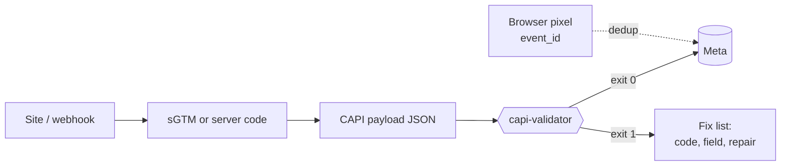

`Tool / server-side tracking`

# server-side-capi-validator

Checks Meta Conversions API payloads before they leave your server: hashing, deduplication keys, timestamps, and required fields, each rule traced to Meta's docs.

`CLI, v0.2.0 · Nov 2026 · Python 3.10+, zero runtime dependencies, runs offline · Fixtures are synthetic, no client data`

---

## The trace

```
□ OBSERVED   event_name, event_time, event_id, action_source, event_source_url, user_data
↓ TRACED     each field against Meta's Server Event and Customer Information Parameters docs
× BROKEN     raw email or phone; unhashed, uppercase or malformed hashes; missing event_id
             (pixel/server dedup fails); repeated event_name/event_id in one batch;
             event_time in ms, in the future, non-numeric or NaN; unknown action_source;
             website events without client_user_agent or event_source_url; malformed fbc/fbp
+ REPAIRED   capi-validator hash --field <key> prints the normalized SHA-256 value to send
✓ VERIFIED   exit 0 only when every event passes; --strict also fails on warnings
```

## Where it sits



Run it in CI on payload fixtures, on sGTM request logs, or on a webhook body before you send it.

## Scope

**Does:** validate single events, arrays, or `{"data": [...]}` request bodies. Normalize and hash `em ph fn ln ct st zp country ge db` the way Meta documents. Estimate match quality.

**Does not:** call the Graph API, send events, read cookies, map country names to codes, or reproduce Meta's Event Match Quality formula. Meta does not publish that formula. The score here is a weighted heuristic for comparing payloads.

## Evidence

- **[21 rules](docs/meta-rules.md)** traced to Meta's docs, each with its source. Six normalization rules disagreed with the docs in v0.1 and are fixed in v0.2 ([changelog](CHANGELOG.md)).
- **56 tests** (unit and acceptance) pass on Python 3.10–3.14, none skipped. The installed-wheel run repeats the acceptance tests and skips only the 4 lint and typecheck checks, which need the source tree. The acceptance tests were written from the [spec](SPEC.md) before the code. They run twice in CI: against the source, and against the built wheel installed in a clean environment.
- **CI gates:** ruff, ruff format, mypy `--strict`, bandit.
- **[Recorded runs](docs/transcripts/)** of every primary flow. CI regenerates them from the installed wheel and fails if any line changes.

## Install

```bash
pip install "git+https://github.com/ChristopherLandaverde/server-side-capi-validator.git"
```

## Use

```bash
capi-validator inspect payload.json            # check a payload
capi-validator inspect payload.json --strict   # warnings fail the run
capi-validator inspect payload.json --json     # machine-readable report
capi-validator hash "  John_Smith@gmail.com "   # sha256 of john_smith@gmail.com
capi-validator hash "(650)555-1212" --phone     # sha256 of 16505551212
capi-validator hash "07911 123456" --phone --country-code 44   # sha256 of 447911123456
capi-validator hash "2/16/1997" --field db      # sha256 of 19970216
```

```
$ capi-validator inspect fixtures/unhashed_pii.json
[1/1] Lead  event_id=demo_lead_2
  × ERROR     RAW_PII_UNHASHED_EMAIL: Found a raw email address. Normalize (trim, lowercase) and SHA-256 hash it.
  □ WARNING   EVENT_TIME_STALE: 'event_time' is older than 7 days. Meta rejects the whole request if any event in it is this old.
  Estimated match quality: 1.0/10.0 (POOR)
  + Add a SHA-256 hashed, normalized email (+3.0).
Result: FAIL
```

**Exit codes:** `0` pass · `1` a check failed, or there are no events · `2` unreadable file, invalid JSON, a non-CAPI shape, or a value `hash` cannot normalize.

**Errors and warnings.** Errors always fail the run. Warnings (stale `event_time`, uppercase hashes, malformed `fbc`/`fbp`, duplicate IDs in a batch) fail it only under `--strict`.

Staleness is a warning because the check uses the clock at audit time, so replaying last month's sGTM logs would flag every event. Use `--strict` on payloads you are about to send.

## Estimated match quality

| Parameter | Weight |
|---|---|
| Hashed email (`em`) | 3.0 |
| Hashed phone (`ph`) | 2.5 |
| Click ID (`fbc`) | 1.5 |
| Browser ID (`fbp`) | 1.0 |
| `external_id` | 1.0 |
| `client_ip_address` | 0.5 |
| `client_user_agent` | 0.5 |

A parameter earns its weight only when its value is valid. Hashed fields must be lowercase SHA-256, and `fbc`/`fbp` must match `fb.<0-2>.<13-digit ms timestamp>.<id>`.

Grades: EXCELLENT ≥ 8.5 · GOOD ≥ 7.0 · FAIR ≥ 5.0 · POOR below 5.0.

## Develop

```bash
pip install -e ".[dev]"
python -m unittest discover -s tests -v
ruff check . && ruff format --check . && mypy && bandit -q -r server_side_capi_validator -c pyproject.toml
bash scripts/record_transcripts.sh   # regenerate docs/transcripts
```

The build record is in [SPEC.md](SPEC.md), [PLAN.md](PLAN.md), [PROGRESS.md](PROGRESS.md) and [DECISIONS.md](DECISIONS.md).

---

`Independent practice / FOCO Systems`

Built by Christopher Landaverde. If your CAPI numbers don't match what your CRM says happened, start with the decision you can't trust: christopher@focosys.io · field notes ↗ [focosys.io](https://focosys.io)

MIT License.
